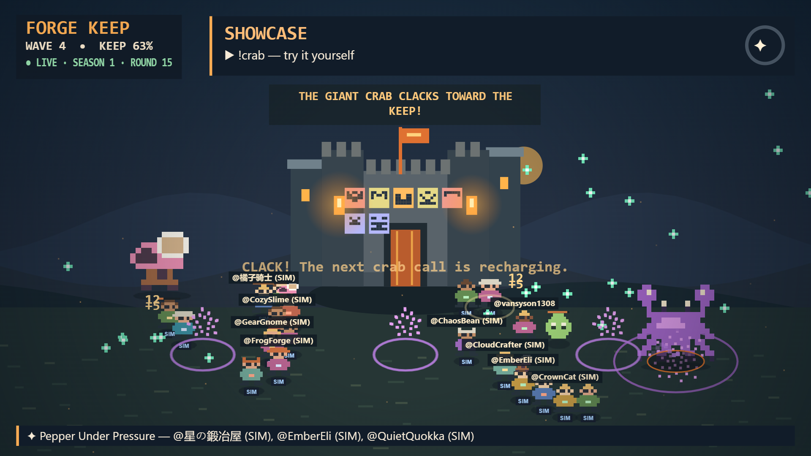
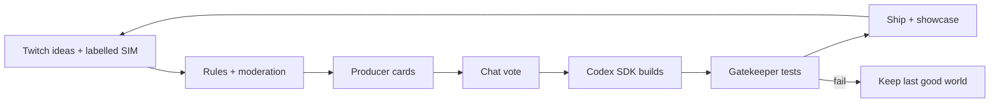

# ChatForge

**Twitch chat doesn't just play the game. Chat ships the game, live.**



[Watch the demo (2:14)](https://youtu.be/tCDQ9QM6JUE) · [Architecture](docs/ARCHITECTURE.md) · [Devpost](docs/DEVPOST.md) · [Live evidence](docs/media/hud/README.md)

## What it does

- Twitch viewers submit `!idea` pitches while their named heroes defend a persistent pixel-art keep.
- A Producer filters and curates three cards; chat chooses a winner with `!vote`.
- The Codex SDK writes a real mod against a constrained API while the stream shows sanitized code and a sprite preview.
- Gatekeeper checks and simulates the candidate; accepted code runs inside QuickJS and is showcased with contributor credits.
- The keep evolves across rounds, with patch history, rollback, Safe Mode and a localhost streamer dashboard.

## A round



## How Codex was used

Codex built ChatForge from an empty folder in one main working thread, guided by the lead prompts in [`brief/prompts/`](brief/prompts/) and documented in the [Codex journey](docs/CODEX_JOURNEY.md). Separately, the **Codex SDK is the live Builder inside ChatForge**: it writes each candidate mod in a restricted workspace and runs the local test before the host independently gates it.

Evidence: the 45-minute SIM soak delivered **21/21 real builds LIVE**; a Twitch + SIM verification shipped **3/3 on attempt one**, with a median build time of **40.3 seconds** ([report](docs/media/hud/final-live-report.json)). A subsequent public Twitch recording captured two more shipped showcases and real chat. In the final demo take, a real Twitch idea from @vansyson1308 became card one, won the chat vote and shipped as Keep Calm and Roar, credited to that account; the Builder used API-key auth for that run. The latest local suite passed **249 tests**; the project had **19 commits** before the real-take fixes. A [live moderation corpus](docs/media/moderation-live-report.json) passed **26/26** expected decisions, including both real dragon ideas. These are measurements of those runs, not guarantees for future builds.

## Safety and honesty

Generated mods run only in QuickJS with resource limits, never in the page or Node host realm. Gatekeeper performs static validation and deterministic simulations; the live idea feed requires both local rules and OpenAI moderation and fails closed when moderation is unavailable. Viewer text is rendered as text, not HTML. Crowd Sim names and events are labelled **SIM**; its output is not Twitch chat. Moderation and tests reduce risk but cannot guarantee detection of every harmful input or gameplay defect.

## Quick start

Requires Windows 11, Node 24, pnpm 10, Chrome and a Codex login. In PowerShell:

```powershell
corepack enable
pnpm install --frozen-lockfile
Copy-Item .env.example .env
pnpm stream
```

Set the OpenAI API key and available Producer model in `.env`, and run `codex login`. For Twitch, register a Twitch developer application with redirect `http://localhost:3000/auth/twitch/callback`, set its client ID and secret in `.env`, then connect using the localhost dashboard. See [Twitch setup](docs/LIVE_TEST.md) and [.env.example](.env.example). Credentials stay local. Set `CHAT_SOURCE=simulator` to try Crowd Sim without Twitch. Open the dashboard at `http://localhost:3000/dashboard/`; OBS can use the overlay URL printed by `pnpm stream`.

## Architecture and limits

A Node server owns Twitch, rounds, SQLite and a simulation worker. The Canvas overlay renders read-only snapshots; the React dashboard controls localhost. See [architecture and trust boundaries](docs/ARCHITECTURE.md) and [Mod API](docs/MOD_API.md). Live AI calls consume API credits and Codex usage; model availability, Twitch connectivity and generated results vary. Existing older mods predate the current showcase admission rule.

All built-in artwork is generated by the project. [MIT license](LICENSE).
