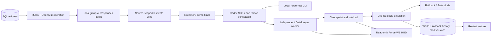
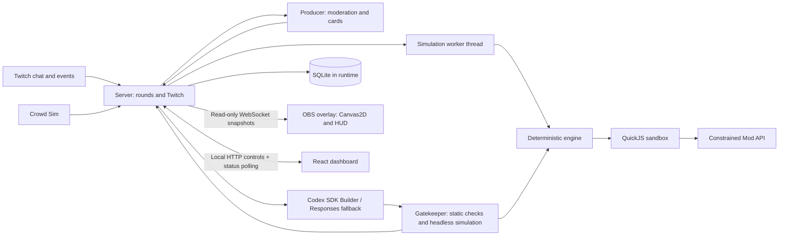
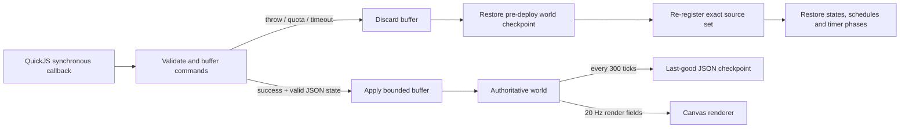
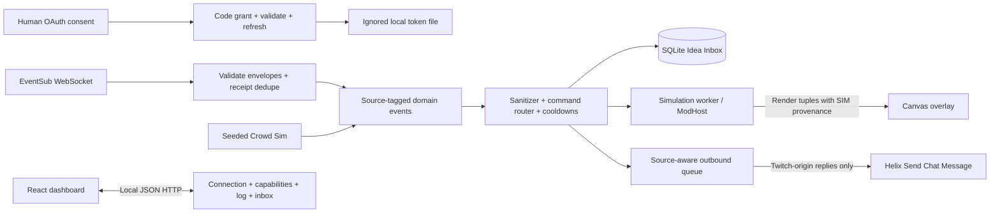

# Architecture

## M4 finish and M5 hardening

The architecture remains server-authoritative. HUD content has named, opaque slots and is derived from the current Forge state; the same credit formatter is used for chat, dashboard and overlay. Generated emblems represent shipped patch IDs on the keep; added towers, lanterns and flags show progress at three-patch intervals. Ground enemies attack the keep, and persistent mod props are clamped to left flank, right flank, ramparts or sky decor anchors.

The streamer may enable oldest-first active-mod retirement and choose the limit. The SQLite retirement record and worker checkpoint are committed together; history and credits remain in the Hall. Removing a mod cannot reverse its previously applied world-rule changes without replaying subsequent mods, so those changes remain. The server exposes a local Go-Live readiness view and an opt-in OpenAI check; a present Codex login file is reported as presence, not remote authentication success.

CI runs the fake-EventSub-to-real-QuickJS end-to-end flow and an isolated 15-mod benchmark in addition to unit and security checks. The longer paid soak uses its own SIM-only database and reports real Producer and Codex outcomes, including a mid-season restart.

## M3 delivered Forge loop

M2 passed a real Twitch live test on `vansyson1308`, including all seven subscriptions and chat delivery. M3 preserves the seven-package architecture. See [FORGE_LOOP.md](FORGE_LOOP.md) for controls, persistence and real dry-run evidence.

Separate collecting/building round records allow collection during a build with one build slot. Every transition is persisted before broadcast. Demo uses 45/30/10 seconds; Normal uses 90/45/manual approval. SQLite stores seasons, rounds/transitions, cards, votes, builds/reports/thread IDs, mod versions and contributors. The worker publishes a complete checkpoint including rollback history every 300 ticks. Startup restores it and marks interrupted AI work failed rather than silently billing or deploying. Patch notes derive from persisted shipped cards and credits.

Part A fixes: cross-site Fetch Metadata exceptions apply only to top-level GET document navigations for static pages/OAuth; APIs, mutations and WS stay strict. Outbound prefix `\u2692` is verified as UTF-8 E2 9A 92. Simulator RNG checkpoints and a partial SQLite unique index on pending normalized source/user/text prevent replay duplicates across toggles/restarts. Migration retains historical duplicates as rejected rows.

The decided architecture is specified in [the brief](../brief/CHATFORGE_BRIEF.md), especially §3. It is the source of truth; this document summarizes it.

TypeScript, Node 24, ESM, strict TypeScript and pnpm workspaces span seven packages:

- `apps/server`: Twitch OAuth, EventSub WebSocket and Helix chat; rounds; Producer, Codex SDK Builder and Responses fallback; deterministic Gatekeeper; SQLite persistence; WebSocket hub; serves built applications.
- `apps/overlay`: Vite, TypeScript and Canvas2D snapshot renderer and Forge HUD for the OBS browser source.
- `apps/dashboard`: Vite and React streamer controls.
- `packages/engine`: deterministic fixed-tick, seeded, ECS-lite game runtime running in a server-owned Node worker or headless tests.
- `packages/sandbox`: QuickJS in Node, bounded memory and time, interrupt handler and no host access.
- `packages/mod-api`: the sole typed surface exposed to mods, including Builder documentation and examples.
- `packages/shared`: protocol types and Zod schemas for WebSocket messages and persisted records.
- `runtime/` (ignored): Builder workspace, SQLite database, tokens and logs.

The server is authoritative: the worker owns the engine and mods, while overlay clients interpolate snapshots to 60 fps. Tests and the Gatekeeper use the same engine headlessly. Rounds collect ideas, curate three cards, vote, optionally request streamer approval, build, test, deploy and return to live; failures and rollback retain the last good mod set. Mods are single ES2020 files exporting `register(api)` and run only inside QuickJS. See the brief for budgets, Twitch scopes, state transitions and security requirements.

## M1 execution and rollback decisions (lead QC)

The worker simulates at 30 Hz and broadcasts compact render-only tuples at 20 Hz. Tuples contain ID, kind, team, position, HP, viewer name, level and join tick. No RNG, mod source, JSON state, schedules or simulation internals cross the overlay socket. `packages/shared/src/protocol.ts` defines the Zod schema; the overlay rejects malformed messages and interpolates over 50 ms.

The engine indexes entities by ID and rebuilds an 80-unit spatial grid each tick. Nearest/radius queries and projectile collisions use that grid; heroes apply local separation steering. Full state hashes and JSON copies are checkpoint/test operations, not per-entity or per-callback work.

`register` is declarations only. Named schedules replace delayed closures. The snapshot includes mod-set version, source for each mod, declaration tick, JSON state, repeating timer phase, pending named schedules and command cooldowns. Checkpoints happen before deployments and every ten simulated seconds; error diagnostics live outside simulation state, preserving exact rollback hashes. Explicit `rollbackToLastGood()` restores the periodic checkpoint. Full world/round persistence and Gatekeeper admission remain M3; M2 persists ideas and EventSub receipt IDs only.

## M2 Twitch and Crowd Sim

`TwitchAuth` owns a browser-bound five-minute single-use state, code exchange, `/users` identity lookup and atomic token storage. Startup/hourly validation checks client ID, user ID and granted scopes; a minute maintenance loop proactively refreshes near expiry, and Helix retries once after a 401. Concurrent refresh calls share one request. Failure/revocation ends the EventSub connection and clears pending outbound chat, leaving the game running with a reconnect prompt. The streamer's account is the broadcaster and bot.

`EventSub` creates all seven subscriptions immediately after a new welcome. A Twitch-requested reconnect opens the supplied URL, retains the old connection until the new welcome, and transfers existing subscriptions. Unexpected close/keepalive timeout reconnects with bounded exponential backoff and creates fresh subscriptions. Per-type API refusals remain visible without taking down other types. Receipt IDs are persisted before routing; duplicate IDs are ignored across handoff, source toggles and process restarts. A ten-minute timestamp window bounds replay history; expired receipts are pruned on incoming traffic. Twitch does not replay events missed during a disconnected session.

Both sources emit shared Zod domain shapes. Chat identities use source + user ID, not display names; engine checkpoints and queued viewers preserve that identity and SIM provenance. Names remain display-only. Events forward sanitized viewer, source, user ID, count and subtype into the existing ModHost bus. Commands unknown to the registered mods have no effect. `!idea` writes a pending row to SQLite and a bounded memory inbox; `!vote` retains preview choices without pretending M3 rounds exist. The router exposes `resetRound()` for M3. Input cooldowns and the 200-idea round limit are separate from Mod API cooldowns.

Crowd Sim has 20 personas, 80 buildable ideas and 10 deliberately bad moderation fixtures. Seeded selection is deterministic; intensity changes only pacing (4000/1200/250 ms). SIM appears in dashboard logs/inbox, hero labels, persistent small hero markers and simulated event/command credits. Simulated replies are logged locally and rejected by the real outbound queue. The queue prefixes `?` exactly as requested, caps at 500 Unicode code points, suppresses identical messages for 60 seconds, bounds pending messages at 20 and spaces sends by 1600 ms. HTTP 429 respects the later of Twitch's reset time and a 30-second retry delay. API refusal/drop results are displayed without exposing response bodies.

The React dashboard polls a bounded status payload once a second, cleans up polling on unmount, and sends source/intensity/auto-join changes through JSON POST. This is the functional M2 control surface; M4 owns the visual polish pass. `pnpm start` serves both built apps from the same loopback server; `pnpm dev` also starts Vite on 5173/5174. The overlay socket remains read-only and exposes no OAuth or chat administration. See [LIVE_TEST.md](LIVE_TEST.md) for the intentionally human-only OAuth hand-off and official Twitch references.

M1's isolated performance suite measures 300 entities, three active example mods, scheduled events and periodic checkpoints for 900 measured ticks after 120 warm-up ticks. Local limits: average ≤3 ms, p99 ≤10 ms, max ≤25 ms; CI scales each limit by three. Unit/security tests also run sequentially to reduce scheduling contention. Sandbox limits use thread CPU time with a secondary wall deadline; performance gates always use elapsed wall time. Browser FPS is a separate local installed-Chrome gate, with at least 300 durable test heroes for the entire ten-second sample.

## M4 extensions

Architecture remains server-authoritative worker + QuickJS + Canvas2D + React. The engine now owns ground lanes, scalable siege waves, fifth-wave bosses, keep rebuild cycles and bounded projectile lifetime. Mod API v1.1 adds bounded visual primitives, scaled entities, hats and passive props; compact render tuples append optional scale/hat fields. Overlay sound is synthesized locally from a finite cue allowlist and starts muted.

Gatekeeper preflights the existing world separately and shares immutable admission inputs with the Builder CLI. Spectacle evidence (drawn sprites, spawned entities, commands, FX diversity/duration) accompanies security/determinism checks. No AI output executes in Node or the browser. The Producer's model output never decides idea identity: server-owned IDs resolve selected groups to credits/statuses.
