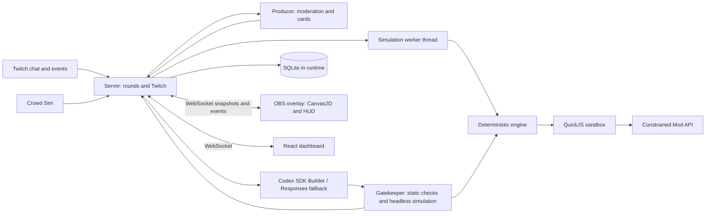
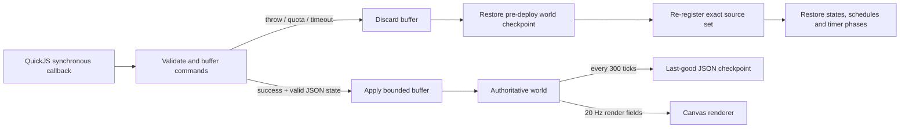

# Architecture

The decided architecture is specified in [the brief](../brief/CHATFORGE_BRIEF.md), especially §3. It is the source of truth; this document summarizes it.

TypeScript, Node 24, ESM, strict TypeScript and pnpm workspaces span seven packages:

- `apps/server`: Twitch OAuth, EventSub WebSocket and Helix chat; rounds; Producer, Codex SDK Builder and Responses fallback; deterministic Gatekeeper; SQLite persistence; WebSocket hub; serves built applications.
- `apps/overlay`: Vite, TypeScript and Canvas2D snapshot renderer and Forge HUD for the OBS browser source.
- `apps/dashboard`: Vite and React streamer controls.
- `packages/engine`: deterministic fixed-tick, seeded, ECS-lite game runtime running in a server-owned Node worker or headless tests.
- `packages/sandbox`: QuickJS in Node, bounded memory and time, interrupt handler and no host access.
- `packages/mod-api`: the sole typed surface exposed to mods, including Builder documentation and examples.
- `packages/shared`: protocol types and Zod schemas for WebSocket messages and persisted records.
- `runtime/` (ignored): Builder workspace, SQLite database, tokens and logs.

The server is authoritative: the worker owns the engine and mods, while overlay clients interpolate snapshots to 60 fps. Tests and the Gatekeeper use the same engine headlessly. Rounds collect ideas, curate three cards, vote, optionally request streamer approval, build, test, deploy and return to live; failures and rollback retain the last good mod set. Mods are single ES2020 files exporting `register(api)` and run only inside QuickJS. See the brief for budgets, Twitch scopes, state transitions and security requirements.

## M1 execution and rollback decisions (lead QC)

The worker simulates at 30 Hz and broadcasts compact render-only tuples at 20 Hz. Tuples contain ID, kind, team, position, HP, viewer name, level and join tick. No RNG, mod source, JSON state, schedules or simulation internals cross the overlay socket. `packages/shared/src/protocol.ts` defines the Zod schema; the overlay rejects malformed messages and interpolates over 50 ms.

The engine indexes entities by ID and rebuilds an 80-unit spatial grid each tick. Nearest/radius queries and projectile collisions use that grid; heroes apply local separation steering. Full state hashes and JSON copies are checkpoint/test operations, not per-entity or per-callback work.

`register` is declarations only. Named schedules replace delayed closures. The snapshot includes mod-set version, source for each mod, declaration tick, JSON state, repeating timer phase, pending named schedules and command cooldowns. Checkpoints happen before deployments and every ten simulated seconds; error diagnostics live outside simulation state, preserving exact rollback hashes. Explicit `rollbackToLastGood()` restores the periodic checkpoint. SQLite persistence and Gatekeeper admission remain M3.

M1's isolated performance suite measures 300 entities, three active example mods, scheduled events and periodic checkpoints for 900 measured ticks after 120 warm-up ticks. Local limits: average ≤3 ms, p99 ≤10 ms, max ≤25 ms; CI scales each limit by three. Unit/security tests also run sequentially to reduce scheduling contention. Sandbox limits use thread CPU time with a secondary wall deadline; performance gates always use elapsed wall time. Browser FPS is a separate local installed-Chrome gate, with at least 300 durable test heroes for the entire ten-second sample.
