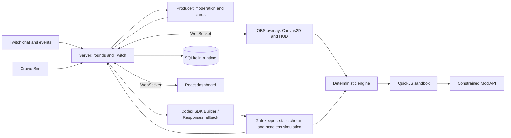

# Architecture

The decided architecture is specified in [the brief](../brief/CHATFORGE_BRIEF.md), especially §3. It is the source of truth; this document summarizes it.

TypeScript, Node 24, ESM, strict TypeScript and pnpm workspaces span seven packages:

- `apps/server`: Twitch OAuth, EventSub WebSocket and Helix chat; rounds; Producer, Codex SDK Builder and Responses fallback; deterministic Gatekeeper; SQLite persistence; WebSocket hub; serves built applications.
- `apps/overlay`: Vite, TypeScript and Canvas2D game renderer and Forge HUD for the OBS browser source.
- `apps/dashboard`: Vite and React streamer controls.
- `packages/engine`: deterministic fixed-tick, seeded, ECS-lite game runtime shared by browser and headless Node.
- `packages/sandbox`: QuickJS in browser and Node, bounded memory and time, interrupt handler and no host access.
- `packages/mod-api`: the sole typed surface exposed to mods, including Builder documentation and examples.
- `packages/shared`: protocol types and Zod schemas for WebSocket messages and persisted records.
- `runtime/` (ignored): Builder workspace, SQLite database, tokens and logs.

Rounds collect ideas, curate three cards, vote, optionally request streamer approval, build, test, deploy and return to live; failures and rollback retain the last good mod set. Mods are single ES2020 files exporting `register(api)` and run only inside QuickJS. See the brief for budgets, Twitch scopes, state transitions and security requirements.
